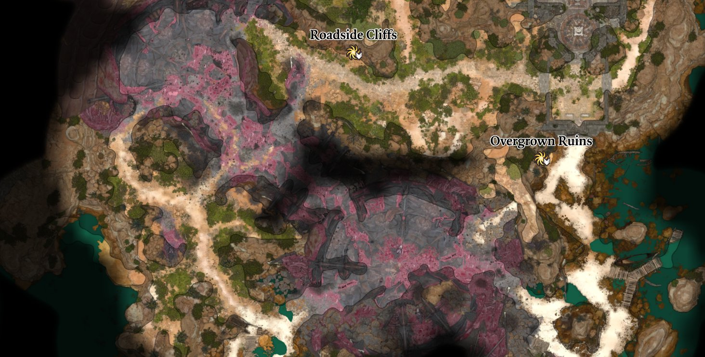

# Minimap Cleared

Removes the black grid lines from the minimap, for a clean map view.

## What it does

- The minimap no longer shows the black grid lines. You see the map itself, without a grid on top.
- The change is there for keyboard and mouse and for a controller.
- Nothing else changes, and there is nothing to set up.

## Screenshots

## How to install

1. Download `bg3_minimapcleared.pak` from the latest release on GitHub.
2. Copy it to `%LOCALAPPDATA%\Larian Studios\Baldur's Gate 3\Mods`.
3. Enable **Minimap Cleared** in your mod manager (BG3 Mod Manager or the in-game mod manager).

To update the mod, replace the `.pak` with the one from the new release. To remove it, disable it in the mod manager
and delete the `.pak`. Saves made with the mod can then show a warning about a missing mod.

## Compatibility

- Game version: Patch 8
- Other mods that change the style of the map (`ls:LSWorldMap`) conflict with this one: the mod that loads later
  wins.

## Known issues

None yet.

## How to build

Anyone can build this mod from its source code and check that the download matches it.

1. Install the tools: Windows PowerShell 5.1 (part of Windows) and [LSLib](https://github.com/Norbyte/lslib/releases)
   v1.20.4. Put LSLib into a folder `_tools\lslib\` above the repository, or set `BG3_TOOLS` to the folder that holds
   `lslib\`.
2. Build it: `powershell -ExecutionPolicy Bypass -File .\build.ps1`
3. Find the file: `dist\bg3_minimapcleared.pak`

## Credits

Made by Kintaro. MIT license: you may use, change and share this mod.
